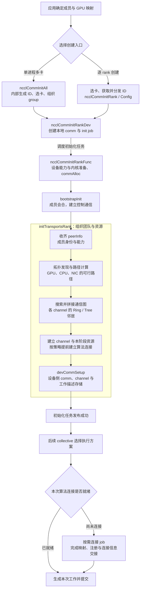

# 05｜初始化：从应用 API 到可执行的通信团队

初始化是 NCCL 中跨模块最广的工作之一：它把独立的进程、GPU 和网络资源组织成一个通信团队。应用只需调用少量 API，内部则要完成成员会合、拓扑发现、通信图构造、资源连接和设备状态准备。

**Communicator（通信域）**保存这组成员的通信关系与资源。每个成员称为一个 **rank**，各自持有本地 `ncclComm_t` 句柄，后续多轮通信复用其中的状态。

本章先看应用选择哪个 API，再沿内部流程追踪每个阶段的产物。源码基线为 NCCL **2.32.3**，提交 `12df1a11`。

## 1. 应用侧：初始化 API 怎么选

创建同一个通信组时，按进程组织和配置需求选择一种入口：

| 场景 | 创建接口 | 应用提供什么 | 得到什么 |
|---|---|---|---|
| 单进程管理多张 GPU，使用默认配置 | `ncclCommInitAll` | GPU 数、设备列表、接收句柄的数组 | 每张 GPU 对应的 comm；列表顺序决定 rank |
| 多线程或多进程，每次创建一个 rank | `ncclCommInitRank` | rank 总数、同一个 uniqueId、本 rank 编号；提前选好设备 | 当前 rank 的 comm |
| 需要指定配置，例如非阻塞初始化 | `ncclCommInitRankConfig` | InitRank 的参数，加 `ncclConfig_t` | 按配置创建的 comm |
| 大规模初始化，希望分担引导工作 | `ncclCommInitRankScalable` | rank 信息、多个 uniqueId 和配置 | 使用多个引导入口建立的 comm |

Config 是 InitRank 的可配置形式。用 `NCCL_CONFIG_INITIALIZER` 初始化配置，再设置需要的字段，例如 `blocking=0`。Scalable 允许使用多个 ID，各 rank 传入的 ID 数量和顺序保持一致。

创建入口之外，还有三个配套动作：

- **选设备：**InitRank 系列读取当前 CUDA device，应用先调用 `cudaSetDevice(device)`。
- **分发令牌：**常规 InitRank 流程由一个参与者调用 `ncclGetUniqueId`，应用通过 MPI、启动器或自己的控制通道分发 ID。
- **组织提交与查询：**单线程逐个初始化多个 rank 时，用 `ncclGroupStart/End` 让初始化一起推进；非阻塞模式用 `ncclCommGetAsyncError` 查询主机状态。

InitAll 在内部生成 ID、逐卡选设备并组织 group。理解多进程流程后，就能看懂它封装了哪些工作。

公共契约见 [nccl.h.in:275–301](../../nccl/src/nccl.h.in#L275)，Scalable 见 [nccl.h.in:365](../../nccl/src/nccl.h.in#L365)。两个完整用法分别在[单进程示例](../examples/single_process_allreduce.cu#L73)和[MPI 示例](../examples/mpi_allreduce.cu#L82)。

## 2. 概览图：少量 API 怎样展开成整套准备工作

下图沿普通初始化路径展开。方框表示主要阶段，带“调度”的箭头表示任务交接；`initTransportsRank` 内部承担了从成员信息到设备状态的多项工作。



**初始化建立可复用的团队和资源，每次 collective 再填入当前数据的工作描述。** 因此图的前半部分通常只做一次，末尾的选择与提交会反复执行。

图中以单 ID 的 InitRank/Config 展开；Scalable 携带多个 ID 汇入相同的内部初始化入口。按需连接的具体条件见第 5 节。

## 3. 应用先确定：谁参加、用哪张卡、怎样会合

沿用两主机各四 GPU 的案例，每进程管理一个 rank。各 rank 后续对 64 MiB FP32 做 Sum AllReduce，`count=16*1024*1024`。

| 身份 | 主机 A | 主机 B |
|---|---|---|
| communicator rank | 0、1、2、3 | 4、5、6、7 |
| 物理 GPU | A0、A1、A2、A3 | B0、B1、B2、B3 |
| 本例的 local rank | 0、1、2、3 | 0、1、2、3 |

**CUDA device ordinal** 是当前进程可见设备列表中的索引。如果启动器给每个进程只暴露一张卡，八个进程都选 device 0。例如 r5 使用物理 GPU B1，传入 `rank=5`，调用的却是 `cudaSetDevice(0)`。

**Local rank** 是节点成员集合中的编号；本例 r5 的 local rank 为 1。`intraRank/intraRanks` 描述同进程的成员关系，本例每进程一张 GPU，所以分别为 0 和 1。

**UniqueId** 是初次会合的不透明令牌，携带引导端点和匹配信息。八个进程拿到同一个 ID，使用相同的 `nranks=8` 和各自唯一的 rank 进入初始化：

```text
应用 / 启动器：确定 rank 与 GPU，分发 uniqueId
                         ↓
各 rank：ncclCommInitRank(&comm, 8, id, rank)
                         ↓
NCCL：接手成员交换、拓扑与资源准备
```

这次交接给 NCCL 三项输入：**成员规模、本端身份、共同会合令牌**。设备放置由应用决定；进入 NCCL 后，各 rank 才逐步收齐团队视图。

## 4. 内部各阶段：输入什么，留下什么

把概览图换成对象视角，可以得到下面这张交接表：

| 阶段 | 主要输入 | 产物 → 下一消费者 |
|---|---|---|
| 创建本地对象和任务 | rank、device、ID、config | `comm`、init job → 初始化任务执行器 |
| 建立引导通信 | ID 中的会合信息 | `comm->bootstrap`、成员联系地址 → 控制消息交换 |
| 交换身份与能力 | 各 rank 的本地记录 | `peerInfo[]`、同主机/同进程关系 → 拓扑与资源协商 |
| 发现硬件、计算路径 | 成员设备身份、系统与网络属性 | `comm->topo`、paths → 图搜索与选路 |
| 构造通信布局 | 可行路径、带宽与算法模式 | 算法图、节点/rank 映射、各 channel 的邻居 → transport 建连 |
| 准备连接资源 | peer、channel、传输能力 | connector、缓冲、映射与注册状态 → GPU 或 proxy |
| 准备设备状态 | 本 rank 的通信布局与资源 | `comm->devComm`、设备 channel、work FIFO → 后续 launcher 与 kernel |

下面抓住四个关键交接，就能把这张表接到代码上。

### 4.1 本地对象 → init job

`ncclCommInitRankDev` 分配 comm、解析配置，将 `initState` 设为 `ncclInProgress`。它把 `comm、nranks、myrank、cudaDev` 放进 init job，并复制 ID，让任务拥有自己的参数存储。

任务由 `ncclCommInitRankFunc` 执行。它选定设备，查询架构能力、准备 NCCL kernel，再通过 `commAlloc` 完善本地运行状态。任务的具体执行线程由 group/异步调度路径组织。

### 4.2 引导通信 → 成员信息

`bootstrapInit` 负责成员会合，并建立用于控制消息的连接。常规 socket 分支组成 bootstrap ring，交换成员与 proxy 的联系地址。

进入 `initTransportsRank` 后，各 rank 用 `fillInfo` 生成自己的记录，再通过 `bootstrapAllGather` 收齐 `peerInfo[]`。其中 `hostHash/pidHash` 表达主机与进程关系，`busId/gpuUuid` 标识设备，其他字段描述版本和能力。

这套控制通信承载身份、图摘要和连接句柄。后续 64 MiB 用户数据沿 transport 建好的数据连接传输。

### 4.3 成员与硬件信息 → 算法邻居 → 连接

拓扑层用成员设备身份关联 GPU、CPU 和 NIC，计算可行路径，再搜索 Ring/Tree 等通信布局。**Channel** 是并行通信的一组逻辑资源，每个 channel 都需要知道自己的算法邻居。

例如某条 Ring 边是 r1→r5。图构造阶段留下的是“r1 的后继为 r5”；transport 随后为这条跨主机边选择 NET，建立网络端点、缓冲及所需注册，填入连接信息。

**Proxy** 在 CPU 侧代办连接资源服务，并为部分传输推进网络请求。连接信息准备好后，GPU 和 proxy 才能按各自职责使用它。

[第 06 章](../06-topology.md)展开从硬件图到邻接关系的过程，[第 07 章](../07-transports.md)展开从邻接关系到可访问资源的过程。

**图搜索完成后，还要经过一次全局协调，才能形成所有 rank 一致的 Ring/Tree。** 普通新建 communicator 的主要交接是：

```text
各 rank 的 ncclTopoCompute
  → ncclTopoPreset：提取本地 Ring/Tree 端点与邻居摘要
  → bootstrapAllGather：交换 graphInfo + topoRanks
  → 建立 rankToNode/localRank，并对齐 channel 数、带宽和路径约束
  → ncclTopoPostset：拼接跨节点邻接，生成并校验 rings
```

这里交换的不是整张 `ncclTopoSystem`，而是两类摘要：`graphInfo` 保存 channel 数、带宽和路径约束，`topoRanks` 保存局部段的连接端点。`ringRecv/ringSend` 是局部 Ring 段的入口和出口，**不是当前 rank 自己的 recv/send peer**；当前 rank 的局部前后邻居另由 `ringPrev/ringNext` 表示，跨节点边界则由 Postset 补齐。

因此，`ncclTopoCompute` 的输出只是局部算法布局；`ncclTopoPostset` 之后，`comm->channels[c]` 中的 `ring.prev/next` 和 `tree.up/down` 才是后续 transport 使用的全局逻辑邻接。`ncclBuildRings` 还会沿 `next` 走完整环，检查回到起点且覆盖所有 rank。

### 4.4 主机状态 → GPU 可用的执行上下文

`devCommSetup` 创建普通通信 kernel 使用的 `ncclKernelComm` 与设备 channel，填入 rank、协议缓冲大小、设备地址和终止标志等信息，同时准备 work FIFO 等存储。

**Work FIFO** 保存后续提交的设备工作描述。初始化准备好这块存储，每次 collective 的 planner 再填入当前任务的地址、范围和执行参数。

完成本分支要求的准备与协调后，`ncclCommInitRankFunc` 发布 `initState=ncclSuccess`。后续 Host 与 Device 如何使用这些对象，分别见[第 02 章](../02-host-execution.md)和[第 03 章](../03-device-execution.md)。

## 5. 哪些工作在初始化完成，哪些留给首次通信

连接资源有创建成本，NCCL 可以提前连接，也可以等算法首次使用时再连接。本版选择条件为：

```cpp
comm->runtimeConn = comm->cuMemSupport && ncclParamRuntimeConnect();
```

`cuMem` 是 CUDA Driver 的虚拟内存管理接口族。`NCCL_RUNTIME_CONNECT` 默认开启，实际分支还取决于团队的 cuMem 支持。

对普通 Ring/Tree，把两种策略并排看最清楚：

```text
提前连接：channel → 算法连接 → 设备状态 → 初始化就绪 → 后续任务提交
按需连接：channel → 设备状态 → 初始化就绪 → 任务选择算法 → 补齐连接 → 提交
```

按需模式仍会完成本阶段要求的资源准备，包括适用的 NVLS/CollNet setup。首轮任务选择尚未连接的算法时，`ncclPrepareTasks` 设置 `algoNeedConnect`，group 调度连接 job，并等待其成功后继续发射。

因此首轮可能包含额外建连成本，后续任务则复用已有连接。`initAlgoChannels` 在记录需求时就会写入，查连接完成应看 job 结果。

对应用而言，普通阻塞初始化在完成所需主机工作后返回；显式 group 中要等外层 GroupEnd 成功。非阻塞模式查询 `ncclCommGetAsyncError` 时，同时检查函数返回值和输出状态，状态为 `ncclSuccess` 后再使用 comm。通信数据何时可消费，继续按第 01 章的 stream/event 依赖判断。

## 6. 用 r5 串起完整过程

r5 的进程只看到 GPU B1，因而选择 device 0；应用交给它 `nranks=8、rank=5` 和共同 ID。

1. **创建任务。** 本地 comm 交给 init job，任务持有自己的 ID 副本。
2. **形成团队视图。** Bootstrap 建立控制关系；收齐 peerInfo 后，r5 知道 r4～r7 属于主机 B，以及各成员对应的设备。
3. **形成执行布局。** 拓扑和图搜索给出 r5 在每个 channel 中的邻居，transport 按策略准备连接，`devCommSetup` 建立设备状态。
4. **接入第一轮工作。** 初始化就绪后，应用提交 64 MiB AllReduce。若选中的算法还缺连接，先补齐；随后才生成和提交本次工作。

输入数组的地址、count 和规约操作在第 4 步进入任务；前面建立的成员关系、布局和连接继续复用。这就是初始化与执行阶段的分工。

## 7. 源码入口与阅读任务

先抓住三个层次：**公共入口如何组织调用、init job 如何执行、团队资源如何建立。**

| 路径与符号 | 本次阅读重点 |
|---|---|
| [init.cc:2973 · `ncclCommInitAll`](../../nccl/src/init.cc#L2973) | 3016～3025 行生成 ID、逐卡选设备、在 group 中调用共同入口 |
| [init.cc:2851 · `ncclCommInitRankDev`](../../nccl/src/init.cc#L2851) | 创建 comm、复制 ID、提交 init job |
| [init.cc:2105 · `ncclCommInitRankFunc`](../../nccl/src/init.cc#L2105) | 2190 行进入 bootstrap，2196 行进入资源准备，2207 行发布成功 |
| [bootstrap.cc:754 · `bootstrapInit`](../../nccl/src/bootstrap.cc#L754) | 会合、控制连接和联系地址交换 |
| [init.cc:1163 · `initTransportsRank`](../../nccl/src/init.cc#L1163) | 1236～1238 行收齐 peerInfo，1381 行进入拓扑，1414 行开始图搜索，1531～1733 行协调并拼接布局，1811 行决定连接策略 |
| [search.cc:1151 · `ncclTopoCompute`](../../nccl/src/graph/search.cc#L1151) | 硬件路径怎样变成局部 Ring/Tree 图；[connect.cc:20、380](../../nccl/src/graph/connect.cc#L20) 是 Preset/Postset |
| [init.cc:712 · `devCommSetup`](../../nccl/src/init.cc#L712) | 主机状态怎样变成设备 comm、channel 和描述存储；调用处在 1952 行 |
| [generic.cc:14、49 · Ring/Tree transport connect](../../nccl/src/transport/generic.cc#L14) | 读取逻辑邻居，登记并用 `ncclTransportP2pSetup` 完成实际连接 |
| [group.cc:824–828 · 首轮连接 job](../../nccl/src/group.cc#L824) | 结合 [enqueue.cc:572](../../nccl/src/enqueue/enqueue.cc#L572)，追踪需求产生与连接完成 |

**离线任务：给 r5 画一张四行交接表。** 每行写出“执行者 → 产物 → 下一消费者”：

- 应用把哪些信息交给初始化入口？
- Bootstrap 与 peerInfo 交换分别留下什么？
- 图搜索交给 transport 的是什么，transport 又交给 GPU 什么？
- 按需连接开启时，在哪里确认本次算法的连接完成？

核对线索：依次追 `job->comm/commId`、`comm->bootstrap/peerInfo`、`channels[].ring/tree` 与连接信息，最后看 `group.cc:828` 对连接 job 的等待。初始化成功的发布点则是 `init.cc:2207`。

这项阅读不需要 GPU。若有实验环境，可用已有应用分别记录初始化、首轮和预热后通信的耗时，再结合实际连接分支解释差异；本章未提供 GPU 实测数据。资源的正常收尾见[第 09 章](../09-memory-and-lifetime.md)。

下一章：[06｜Topology：从硬件路径到 channel 邻接](../06-topology.md)。
